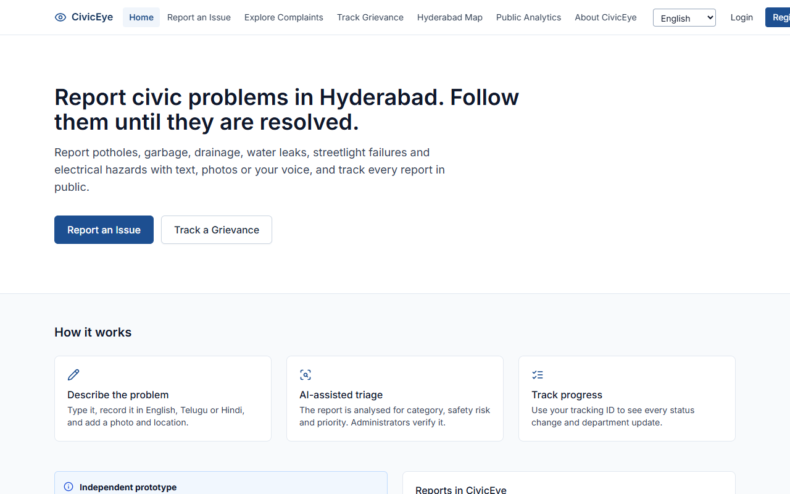
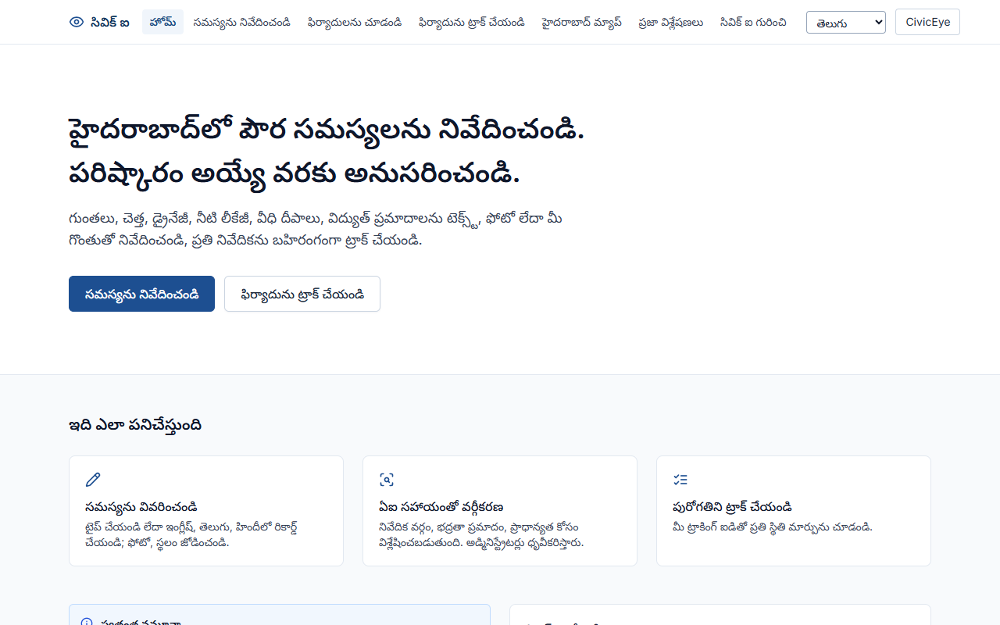
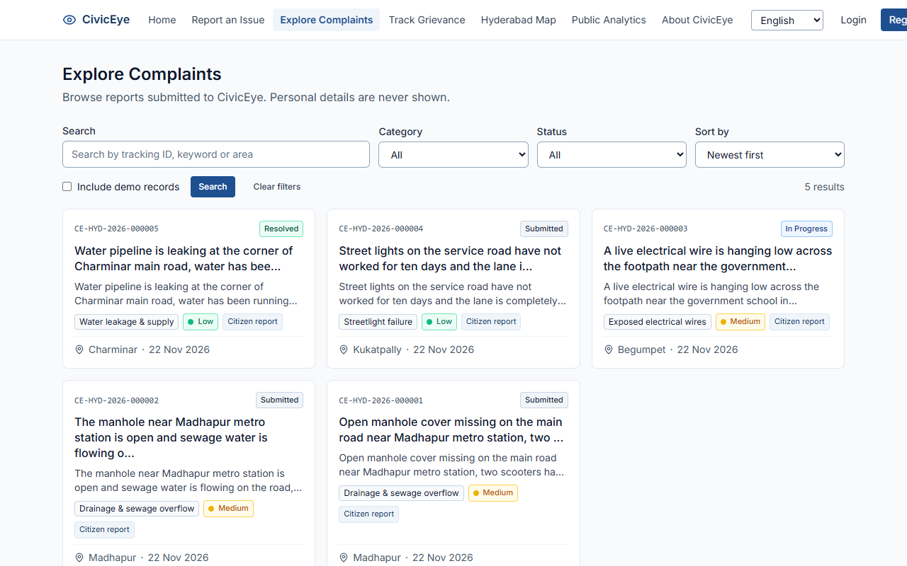
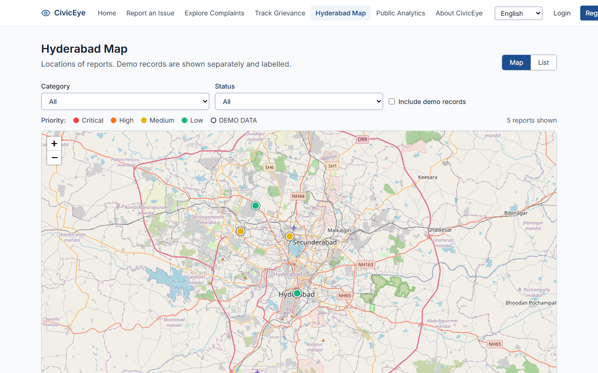
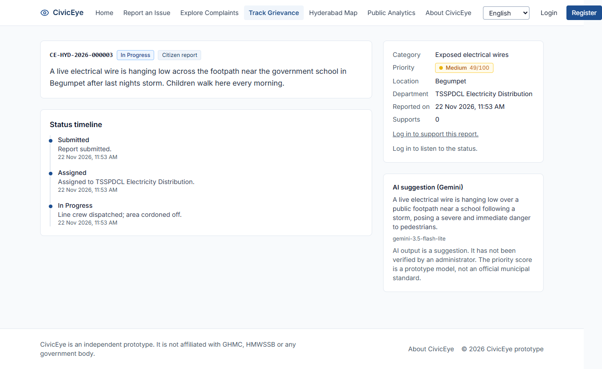
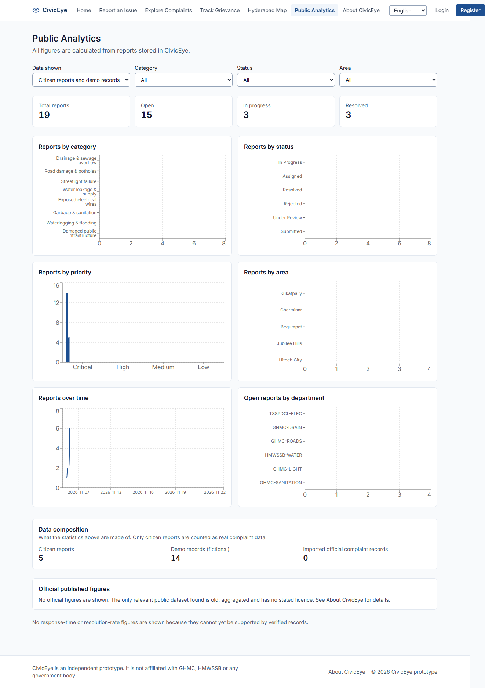
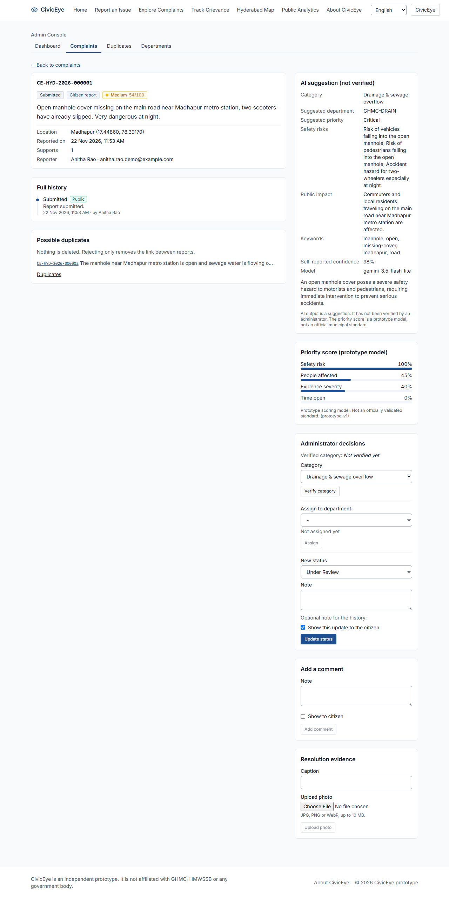
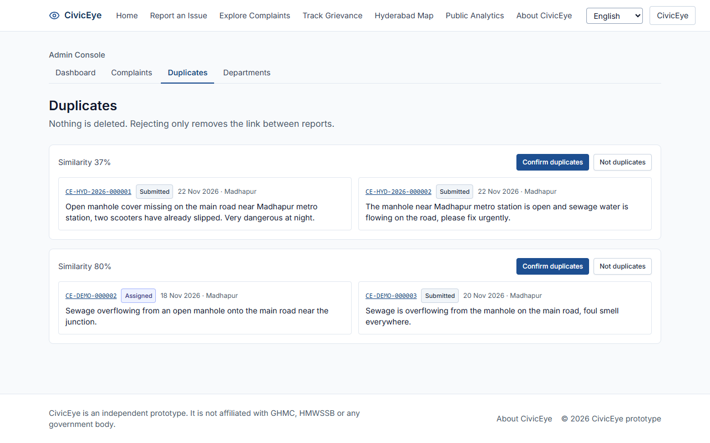
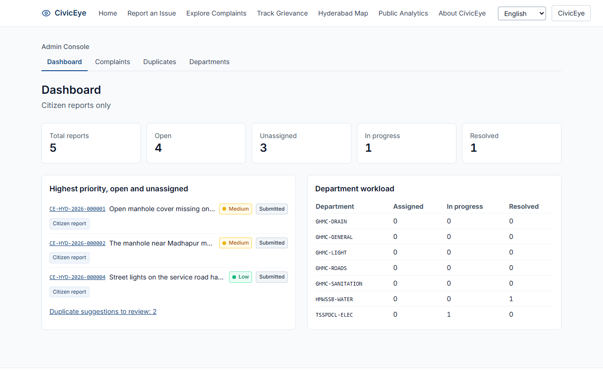
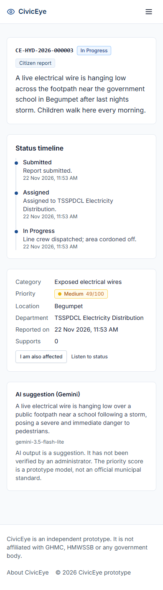

# CivicEye

**An AI-assisted civic grievance reporting and tracking platform for Hyderabad, built to be honest about what it knows.**

Citizens report problems (potholes, garbage, drainage, water leaks, streetlights, exposed wires, damaged
infrastructure, waterlogging) with text, photos or voice in English, Telugu or Hindi. Gemini helps classify and
prioritise each report, administrators verify, assign and resolve it, and every step is visible on a public tracking page.

Built by **Vaishnavi Goriga** as a hackathon and portfolio project.

> **This is an independent prototype.** It is not run by, or connected to, GHMC, HMWSSB, TSSPDCL or any
> government body. Reports made in CivicEye are **not** forwarded to any department. Records labelled
> **DEMO DATA** are fictional. The priority score is a **prototype model**, not an official standard.
> No official complaint data is imported. See [docs/DATA_SOURCES.md](docs/DATA_SOURCES.md) for why.

## The problem

Reporting a civic problem is easy to start and hard to follow up: you rarely learn whether anyone saw it, whether
ten neighbours reported the same pothole, or what happened next. Reports in regional languages and voice notes are
harder still to triage at scale.

## The approach

- **One place to report and follow up.** Text, photo, voice and a map pin in a three-step form, then a public
  tracking page with a timeline, assigned department and resolution evidence.
- **AI as an assistant, never the authority.** Gemini suggests a category, safety risks, department and priority.
  Administrators verify or correct it. The final score is computed by the backend with a transparent, configurable
  formula.
- **Duplicates are linked, never deleted.** Nearby, similar reports (Haversine distance + multilingual text
  similarity) are grouped. Citizens can support an existing report or submit anyway; admins confirm or reject.
- **Honest by design.** Every record has a provenance (`CITIZEN`, `DEMO`, `IMPORTED_OFFICIAL`). Demo data is always
  labelled and excluded from statistics by default. Simulated or failed AI results are labelled as such. When I
  looked for official complaint data I found none that was usable, so the app shows none instead of inventing any.

## Screenshots

<table>
  <tr>
    <td width="50%"><br><sub><b>Home:</b> clear scope and prototype notice</sub></td>
    <td width="50%"><br><sub><b>Telugu, Hindi and English</b> across the whole interface</sub></td>
  </tr>
  <tr>
    <td><br><sub><b>Explore:</b> search, filters, priority sorting</sub></td>
    <td><br><sub><b>Map:</b> OpenStreetMap, priority colours, demo records as hollow rings</sub></td>
  </tr>
  <tr>
    <td><br><sub><b>Tracking:</b> public timeline, AI label, listen and translate</sub></td>
    <td><br><sub><b>Analytics:</b> computed from the database, with a data-composition panel</sub></td>
  </tr>
  <tr>
    <td><br><sub><b>Admin:</b> AI suggestion beside administrator decisions, score breakdown, history</sub></td>
    <td><br><sub><b>Duplicate review:</b> confirm or reject, nothing is deleted</sub></td>
  </tr>
  <tr>
    <td><br><sub><b>Admin dashboard:</b> workload and highest-priority open reports</sub></td>
    <td><br><sub><b>Mobile:</b> responsive layout</sub></td>
  </tr>
</table>

Screenshots show fictional sample reports on a local demo database.

## Engineering highlights

- **Full stack, typed end to end:** React + Vite + TypeScript + Tailwind; Express + TypeScript + Mongoose; Zod validation on every route.
- **Real AI integration, handled carefully:** structured JSON output validated twice (JSON Schema + Zod), complaint text treated as untrusted data,
  timeouts and retries, honest failure states, plus speech-to-text, text-to-speech and translation. A live check script (`npm run ai:smoke`) verifies all of it.
- **Security-minded:** HttpOnly cookie sessions with role re-checked per request, bcrypt, rate limiting, content-based upload validation,
  private voice recordings, strict CORS, no reporter identity in any public response.
- **Tested:** Jest + Supertest API tests (including privacy, authorization and the admin workflow) and Vitest frontend tests. A test keeps
  [docs/openapi.yaml](docs/openapi.yaml) in sync with the real routes, and another fails if a Telugu or Hindi string is missing.
- **Documented:** API reference and OpenAPI spec, as-built architecture, a data-source research report, and a demo script.

## Features

| Area | What it does |
|---|---|
| Reporting | Text, photo (JPG/PNG/WebP up to 10 MB), voice recording with editable transcript, map pin or GPS location, optional category |
| AI (Gemini) | Structured analysis of text and photo, speech-to-text, text-to-speech status reading, on-request translation. Always labelled as a suggestion; failures are reported honestly |
| Languages | English, Telugu, Hindi for the whole interface. Citizen text is never auto-translated; translation is on request |
| Duplicates | Haversine distance + multilingual text similarity + recency. Suggestions only: the citizen can support an existing report or submit anyway; nothing is ever deleted |
| Tracking | Unique tracking ID (`CE-HYD-YYYY-NNNNNN`), public status timeline, resolution evidence |
| Map & analytics | Leaflet/OpenStreetMap map, charts computed from the database, filters, data-composition panel |
| Admin console | Queue with search/filters, AI-vs-verified view, category verification, department assignment, status updates with notes, public/internal comments, evidence upload, duplicate review, department workload |
| Data honesty | Every record has a provenance: `CITIZEN`, `DEMO` or `IMPORTED_OFFICIAL`. Public statistics default to citizen reports only |

Stack: React 18, Vite, TypeScript, Tailwind CSS, Recharts, Leaflet (frontend); Node.js, Express, TypeScript,
Mongoose/MongoDB, Zod (backend); Google Gemini via `@google/genai`.

## Quick start (about 10 minutes)

### Prerequisites

- **Node.js 20 or newer** (developed on Node 24) and npm
- **MongoDB**, one of:
  - a local MongoDB server, or a free [MongoDB Atlas](https://www.mongodb.com/atlas) cluster (recommended for anything beyond a quick look), or
  - the built-in throw-away in-memory MongoDB (`USE_MEMORY_DB=true`). The first start downloads a MongoDB binary
    of about 600 MB; all data is lost whenever the backend restarts.
- A **Gemini API key** is optional. Without one the app runs in a clearly labelled *simulated* demo mode.

### 1. Install

```bash
npm run install:all
```

### 2. Configure the backend

```bash
cd backend
cp .env.example .env        # on Windows PowerShell: Copy-Item .env.example .env
```

Edit `backend/.env`. The minimum for local development:

```ini
JWT_SECRET=<a long random value>          # node -e "console.log(require('crypto').randomBytes(48).toString('hex'))"
MONGO_URI=mongodb://127.0.0.1:27017/civiceye   # or your Atlas URI
# ...or, for a throw-away database instead of MONGO_URI:
# USE_MEMORY_DB=true

ADMIN_EMAIL=you@example.com               # creates your first administrator at startup
ADMIN_PASSWORD=<12+ character passphrase>

SEED_DEMO_DATA=true                       # optional: adds clearly labelled DEMO complaints
GEMINI_API_KEY=<your key>                 # optional; server-side only
```

The frontend works without configuration. `frontend/.env` (optional) only sets `VITE_API_URL`
(default `http://localhost:4000`). **Never put the Gemini key in any `VITE_` variable.**

### 3. Run

Two terminals:

```bash
npm run dev:backend      # API on http://localhost:4000
npm run dev:frontend     # app on http://localhost:5173
```

Open <http://localhost:5173>. Log in with the `ADMIN_EMAIL` / `ADMIN_PASSWORD` you set to reach the
**Admin Console**, or register a normal citizen account.

### 4. Check that it works

```bash
curl http://localhost:4000/api/health      # database "connected", AI configuration
cd backend && npm run ai:smoke             # live check of every Gemini feature (key is never printed)
npm run test:backend && npm run test:frontend
```

## First administrator

There are no built-in or demo credentials. Create the first admin by either:

- setting `ADMIN_EMAIL` and `ADMIN_PASSWORD` in `backend/.env` (created at startup if it does not exist; an
  existing account is never overwritten), or
- running, against a real MongoDB (not the in-memory one):

  ```bash
  cd backend
  ADMIN_EMAIL=you@example.com ADMIN_PASSWORD='a-long-passphrase' npm run create-admin
  ```

Registration always creates citizens. The admin password must be at least 12 characters.

## Demo data

`SEED_DEMO_DATA=true` (or `npm run seed` against a real database) adds 14 **fictional** complaints:

- provenance `DEMO`, tracking IDs `CE-DEMO-000001…`, shown with a **DEMO DATA** badge everywhere
- approximate locations (hollow rings on the map), no photos, a duplicate pair for demonstrations
- never counted in the default statistics: demo records appear only when someone explicitly includes them

A walkthrough that uses this data is in [docs/DEMO.md](docs/DEMO.md).

## Environment variables

All variables live in `backend/.env` (see [backend/.env.example](backend/.env.example) for comments).

| Variable | Default | Purpose |
|---|---|---|
| `PORT` | `4000` | API port |
| `NODE_ENV` | `development` | `development`, `production`, `test` |
| `FRONTEND_URL` | `http://localhost:5173` | The only origin allowed to call the API (CORS) |
| `TRUST_PROXY` | `false` | Set `true` behind a reverse proxy so rate limits see real client IPs |
| `MONGO_URI` | – | MongoDB connection string. Required unless `USE_MEMORY_DB=true` |
| `USE_MEMORY_DB` | `false` | Throw-away in-memory MongoDB. Refused in production |
| `JWT_SECRET` | – (required) | Session signing key. In production it must be 32+ characters and not a known default |
| `JWT_EXPIRES_IN` | `8h` | Session lifetime |
| `ADMIN_EMAIL`, `ADMIN_PASSWORD`, `ADMIN_NAME` | – | First administrator, created at startup if absent (password 12+ chars) |
| `SEED_DEMO_DATA` | `false` | Add labelled DEMO complaints at startup (once) |
| `GEMINI_API_KEY` | – | Enables real AI. Empty = simulated demo mode |
| `GEMINI_MODEL` | `gemini-3.5-flash-lite` | Analysis and translation model |
| `GEMINI_TRANSCRIBE_MODEL` | `gemini-3.5-transcribe` | Speech-to-text |
| `GEMINI_TTS_MODEL` / `GEMINI_TTS_VOICE` | `gemini-3.8-flash-lite-tts` / `Kore` | Text-to-speech |
| `GEMINI_TIMEOUT_MS` | `30000` | Per-call timeout (one retry on timeouts and 5xx) |
| `AI_DEMO_FALLBACK` | `false` | If a Gemini call fails: `false` = save the report with `ai.status "failed"`; `true` = use the labelled keyword simulation |
| `SCORING_WEIGHT_SAFETY/AFFECTED/EVIDENCE/DURATION` | `0.35/0.25/0.20/0.20` | Prototype score weights (normalised to sum to 1) |
| `SCORING_DURATION_SATURATION_DAYS` | `30` | Days until the "time open" factor reaches its maximum |
| `DUPLICATE_RADIUS_METRES` / `_LOOKBACK_DAYS` / `_SCORE_THRESHOLD` | `200` / `30` / `0.3` | Duplicate detection tuning |
| `RATE_LIMIT_GENERAL_MAX` / `_AUTH_MAX` / `_REGISTER_MAX` / `_SUBMIT_MAX` / `_AI_MAX` | `300` / `10` / `10` / `20` / `30` | Requests per window (15 min, 15 min, 1 h per IP, 1 h, 1 h) |
| `SERVE_FRONTEND` | on in production | Serve `frontend/dist` from the API server (single-origin deployment) |
| `MAX_UPLOAD_BYTES` | `10485760` | Upload size limit (10 MB) |

Model names were verified against the live API on 21 Nov 2026. If Google retires one, change the variable and run
`npm run ai:smoke`.

## Scripts

| Command (repo root) | What it does |
|---|---|
| `npm run install:all` | Install backend and frontend dependencies |
| `npm run dev:backend` / `dev:frontend` | Start the dev servers |
| `npm run test:backend` / `test:frontend` | Run the test suites |
| `npm run seed` | Add DEMO data to a real MongoDB |
| `cd backend && npm run create-admin` | Create the first administrator |
| `cd backend && npm run ai:smoke` | Live check of all Gemini features |
| `cd backend && npm run import:aggregate -- --csv f.csv --meta m.json [--approve]` | Import an aggregate official dataset (hidden until approved; see [docs/DATA_SOURCES.md](docs/DATA_SOURCES.md)) |
| `cd backend && npm run build && npm start` | Compile and run the API for production |
| `cd frontend && npm run build` | Typecheck and build the frontend into `frontend/dist` |

## Project structure

```
backend/src
  config/       env validation, database connection
  models/       User, Complaint, ComplaintUpdate, DuplicateGroup, Support, Department, Imported*
  services/     AI (Gemini client, analysis, transcription, speech), scoring, duplicates, analytics, seeding
  controllers/  request handlers      routes/  Express routers (mounted under /api/v1)
  middleware/   auth, rate limiting, uploads (content-checked), error handling
  scripts/      create-admin, seed, ai:smoke, import:aggregate
  __tests__/    Jest + Supertest (in-memory MongoDB)
frontend/src
  i18n/         English, Telugu, Hindi dictionaries (type-checked for completeness)
  pages/ components/ api/ contexts/ routes/ utils/
docs/           ARCHITECTURE, API, openapi.yaml, DATA_SOURCES, DEMO
```

## Security notes

- The Gemini key stays on the server. It is never sent to the browser or logged.
- Sessions are JWTs in `HttpOnly`, `SameSite=Lax` cookies (8 h). Roles are re-read from the database on every request.
- Passwords are hashed with bcrypt (cost 12). Login and registration are rate limited.
- Uploads are validated by content (magic bytes), renamed, and size limited. Voice recordings are private (only the
  reporter and admins can play them).
- Public endpoints never return reporter identity. Admin routes require the `admin` role.
- Production checklist: unique `JWT_SECRET` (32+ chars), a real `MONGO_URI`, `NODE_ENV=production` (secure cookies),
  `FRONTEND_URL` set to the real origin, `TRUST_PROXY=true` behind a proxy, HTTPS, and the frontend and API on the same
  site (the session cookie is `SameSite=Lax`).

## Known limitations

- AI analysis and the score are prototype-quality. The AI's explanations are in English by design.
- Analysis with a photo can take around 20 seconds. Gemini availability and latency are outside this project's control.
- Telugu and Hindi translations are machine-assisted drafts and need review by native speakers.
- No email/SMS notifications, no password reset flow, no push updates (the tracking page is pull-based).
- Uploaded files are stored on local disk (`backend/uploads`). Use object storage for a real deployment.
- Admin names are recorded in the internal history; the public timeline never shows them.
- `npm audit` reports 2 moderate `react-router` advisories that affect server-side rendering only (not used here).
- Tested in the Chromium-based built-in browser at desktop and phone width; not tested on other browsers, with a
  screen reader, or with a real microphone.

## Troubleshooting

| Symptom | Cause / fix |
|---|---|
| Backend exits with `MONGO_URI is not set` | Set `MONGO_URI`, or `USE_MEMORY_DB=true` for a throw-away database |
| First start with `USE_MEMORY_DB=true` is slow | It downloads a ~600 MB MongoDB binary once |
| Sessions and data vanish after the backend restarts | Expected with `USE_MEMORY_DB=true` (and the dev server restarts when files change) |
| Report says "AI analysis was not available" | `GEMINI_API_KEY` is wrong, the model name was retired, or the call timed out. Run `npm run ai:smoke` |
| AI text says "Simulated" | No `GEMINI_API_KEY`, or `AI_DEMO_FALLBACK=true` after a failure. This is the labelled demo mode |
| "Cannot reach the server" in the UI | Backend not running, or `VITE_API_URL` points elsewhere |
| 429 "Too many requests" | Rate limit hit (login: 10 attempts per 15 min per email). Wait, or raise the limit in `.env` for testing |
| Cannot log in as admin | `ADMIN_EMAIL`/`ADMIN_PASSWORD` must be set *before* the backend starts, and the account is not re-created if the email already exists |

## Documentation

- [docs/API.md](docs/API.md) and [docs/openapi.yaml](docs/openapi.yaml): API reference
- [docs/ARCHITECTURE.md](docs/ARCHITECTURE.md): design as built
- [docs/DATA_SOURCES.md](docs/DATA_SOURCES.md): official data research
- [docs/DEMO.md](docs/DEMO.md): demonstration script
- [docs/DEPLOY.md](docs/DEPLOY.md): free deployment with MongoDB Atlas + Render

## License

MIT (see `package.json`). OpenStreetMap data © OpenStreetMap contributors.
